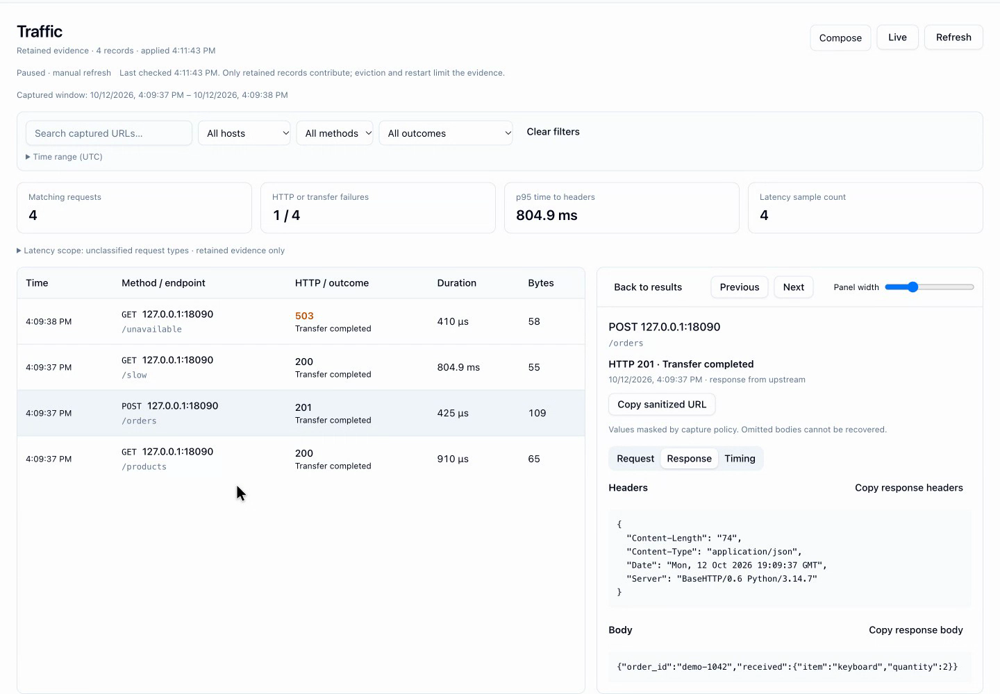
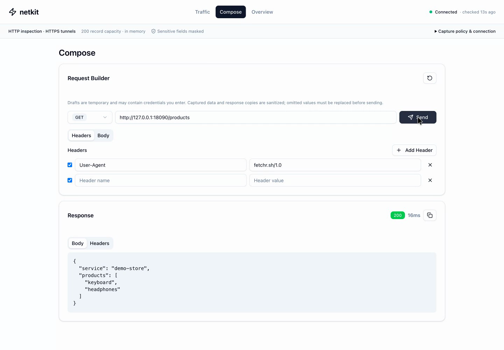

# ⚡ netkit

See what your HTTP traffic is doing. Netkit is a Go proxy with a web dashboard
for inspecting requests, finding slow responses, and investigating failures.

## 🚀 Try it locally

You’ll need **Go 1.24.1+, Node.js 20+, npm, and Python 3.9+** for the demo.

```sh
git clone https://github.com/chaosslabs/netkit.git
cd netkit
make demo
```

Open **[localhost:13000](http://localhost:13000)**. The demo builds Netkit and its
dashboard, starts a local store API, and sends real traffic through the proxy:

- A successful catalog request: **200**
- A JSON order submission: **201**
- A slow upstream response: **~800 ms**
- An unavailable service: **503**

Run `make demo-verify` to send another batch and check the captures. **Ctrl-C**
stops the demo. No external API or credentials needed.

[🎬 Watch the 48-second demo](examples/demo/netkit-demo.mp4) ·
[Demo setup and ports](examples/demo/README.md)

## 👀 See it in action

These screenshots come directly from the recorded demo at 1440×1000.

**Traffic:** filter captured requests and inspect status, headers, JSON bodies,
and timing side by side.



**Compose:** send a request through the proxy and inspect its response.



**Overview** groups retained traffic by host and path, with failure counts and
p95 time to response headers. Drill into a group to inspect its requests.
[More about the investigation workflow →](docs/investigation-workspace.md)

## 🔌 Use it with your app

Build a standalone binary with the dashboard included:

```sh
make install-dashboard
make build-embedded
./bin/netkit serve
```

The normal server uses **3000** for the dashboard, **8080** for the proxy, and
**8081** for the admin API. These differ from the demo’s ports.
Run `./bin/netkit serve --help` for all configuration flags.

```sh
curl --proxy http://localhost:8080 http://example.com

# For applications that support proxy environment variables:
export HTTP_PROXY=http://localhost:8080
export HTTPS_PROXY=http://localhost:8080
```

Prefer Docker? Build from this checkout:

```sh
docker build -t netkit:local .
docker run --rm -p 127.0.0.1:3000:3000 -p 127.0.0.1:8080:8080 netkit:local
```

Open [localhost:3000](http://localhost:3000). The dashboard accesses its admin API
through the same port.

## 🔍 What gets captured?

- **HTTP:** method, sanitized URL and headers, eligible JSON bodies, status,
  byte counts, and timing.
- **HTTPS by default:** CONNECT tunnel setup only. Encrypted requests stay opaque.
- **Optional HTTPS inspection:** decrypted exchanges when clients trust your
  inspection CA. See [HTTPS setup](docs/setup.md#https-inspection).
- **History:** a bounded in-memory buffer, cleared on restart. Default capacity:
  1,000 records; change it with `--history-size`.

Sensitive fields are masked before retention. Only complete JSON bodies up to
64 KiB are retained; other bodies show omission markers. Redaction is not a
general secret detector. See the [capture policy](docs/trustworthy-capture.md).

Netkit has no proxy/dashboard authentication and binds its listeners to all
interfaces. Keep it within a trusted development environment.

## 📊 API and monitoring

The admin API uses port **8081** by default. The dashboard also exposes these
routes under `/api/admin`.

| Endpoint | Purpose |
| --- | --- |
| `GET /healthz` | Health and capture mode |
| `GET /requests` | Retained request history |
| `GET /requests/stats` | Statistics for retained history |
| `GET /metrics` | Prometheus counters and histograms |
| `POST /requests/clear` | Clear retained history |

History statistics cover the current buffer. Prometheus counters survive history
clearing and eviction, but reset when Netkit restarts.

For alerts and retained incident evidence, use the
[Prometheus + Alertmanager example](examples/alerting/README.md).

## 🛠️ Development

```sh
make install-dashboard  # Install frontend dependencies
make dev                # Start backend and dashboard
make test               # Go unit tests
make e2e                # Go end-to-end tests
make check              # Backend tests, lint, and build
```

Dashboard checks: `cd dashboard && npm run test:unit && npm run build`.
Use [Conventional Commits](docs/CHANGELOG_GUIDE.md) and open a PR with your change
and validation results.

## 📚 More details

- [Dashboard configuration and HTTPS setup](docs/setup.md)
- [Capture safety, outcomes, and metric definitions](docs/trustworthy-capture.md)
- [Investigation workspace](docs/investigation-workspace.md)
- [Release and troubleshooting runbook](RUNBOOK.md)
- [Changelog and release workflow](docs/CHANGELOG_GUIDE.md)
